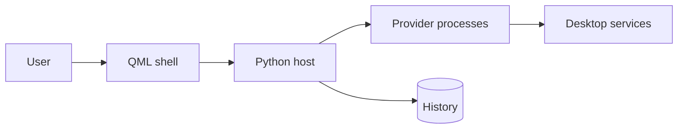

# Pallet wiki

Pallet is a keyboard-driven command palette for Omarchy on Quickshell. The [project README](../README.md) describes installation and user-facing scopes. The plugin entry points are declared in [manifest.json](../manifest.json).

## Architecture at a glance

The [system architecture](./architecture/system.md) is the boundary map. [Plugin shell](./architecture/plugin-shell.md), [provider host](./architecture/provider-host.md), and [provider contract](./architecture/provider-contract.md) cover the three layers. [Summon](./flows/summon.md), [search](./flows/search.md), and [execute](./flows/execute.md) are the interactions.

## Navigation

- **Architecture:** [System](./architecture/system.md) · [Plugin shell](./architecture/plugin-shell.md) · [Provider host](./architecture/provider-host.md) · [Provider contract](./architecture/provider-contract.md)
- **Modules:** [shell](./modules/shell.md) · [host](./modules/host.md) · [apps](./modules/apps.md) · [defaults](./modules/defaults.md) · [files](./modules/files.md) · [menus](./modules/menus.md) · [obsidian](./modules/obsidian.md) · [omarchy](./modules/omarchy.md) · [plugins](./modules/plugins.md) · [run](./modules/run.md) · [system](./modules/system.md) · [windows](./modules/windows.md)
- **Flows:** [summon](./flows/summon.md) · [search](./flows/search.md) · [execute](./flows/execute.md)
- **Concepts:** [provider](./concepts/provider.md) · [result](./concepts/result.md) · [action](./concepts/action.md) · [scope](./concepts/scope.md) · [ranking](./concepts/ranking.md) · [frecency](./concepts/frecency.md) · [confirmation](./concepts/confirmation.md)
- **Guides:** [add-provider](./guides/add-provider.md) · [change-ranking](./guides/change-ranking.md)
- **Existing reference:** [Provider protocol](../docs/PROVIDERS.md), [Architecture](../docs/ARCHITECTURE.md), [Plugin](../docs/PLUGIN.md), [Pallet README](../README.md)
