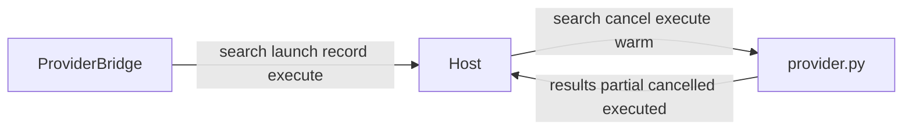

# Provider contract

## Summary

A provider is a subprocess. It speaks newline-delimited JSON on stdin and stdout. It is not a QML plugin. The field list lives in the [provider protocol](../../docs/PROVIDERS.md). This page maps those messages onto the host and the shell.

## Diagram

## Key components

- Each provider directory has a `manifest.json` with `name` and `exec`. `resolve_exec()` rewrites a repo-relative path to an absolute path when that file exists. Optional `minQuery` limits unscoped searches. Scoped searches still reach the provider.
- Host to provider: `search` carries the bare query and the scope. `cancel` names a `target` id. `execute` carries the action object. `warm` uses an empty id and expects no reply.
- Provider to host: a `results` array replaces that provider's rows for the id. `partial: true` means a later complete list will follow. `cancelled: true` drops the provider from the pending set. An `executed` reply may include `error`.
- Shell to host, besides search and cancel: `launch` runs an argv with `spawn_detached()` and no shell. `record` updates history. `execute` is delivered only to the provider named on the message.
- Result fields the shell uses include `title`, `subtitle`, `keywords`, `score`, `id`, `fallback`, plus host-set `provider` and `recent`. Action types handled by [ProviderBridge.qml](../../shell/ProviderBridge.qml) are `launch`, `copy`, `open`, and `custom`.

## Design decisions

Argv is never interpolated into a shell command. `Provider._read_stdout()` forwards `executed` replies with `on_reply` so they never enter the search merge. Lines that are not JSON objects are ignored. A manifest is expected to declare every executable the provider may run. That rule is stated in the [provider protocol](../../docs/PROVIDERS.md).

## Related

[Provider](../concepts/provider.md), [result](../concepts/result.md), [action](../concepts/action.md), [provider host](./provider-host.md), [execute](../flows/execute.md).
