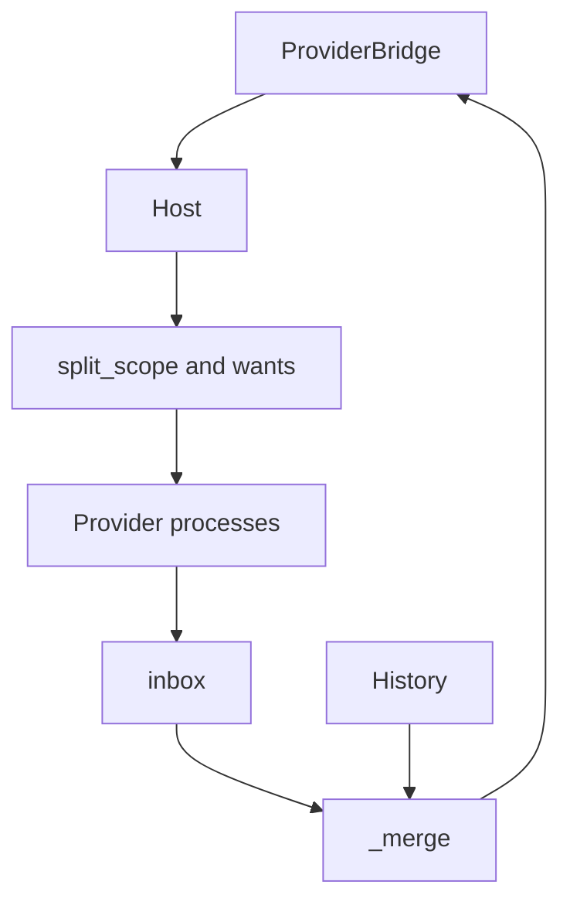

# Provider host

## Summary

[host.py](../../src/host.py) is the process between the QML shell and the provider subprocesses. It routes a query, cancels the previous one, merges newline-delimited replies into one cumulative snapshot, and stamps frecency onto rows. The shell ranks those rows. The [architecture note](../../docs/ARCHITECTURE.md) states the split: providers return data and do not own layout.

## Diagram

## Key components

- `split_scope()` maps a known prefix such as `f:` or `web:` to a provider name and a bare query. An unknown prefix leaves the query unscoped.
- `Provider.wants()` accepts a scoped query only when the scope name is that provider. An unscoped query is skipped when it is shorter than the manifest `minQuery`. files and run use 3. menus and defaults use 2. No current manifest sets `scopedOnly`.
- `Host.on_search()` calls `discard_pending()`, remembers `latest_qid`, starts providers that should answer, sends `op: search`, and runs `_merge()`.
- `_merge()` always emits the full row list so far. Early snapshots set `final` false and list `pending` providers. After `MERGE_TIMEOUT_S` (0.6 seconds) the snapshot is final and lists `unresolved` providers. While client stdin is open, rows that arrive during `LATE_GRACE_S` refresh that final snapshot.
- `Host.on_launch()` passes the action id to `spawn_detached()`. Argv and menu command strings go through a login shell. The attempt is appended to `$XDG_STATE_HOME/pallet/actions.jsonl` (`PALLET_ACTION_LOG` overrides the path; `0` disables it): command, argv, the `bash -lc` exec, pid, exit code, bounded stderr, and an environment snapshot. A later line records a child that was still running after the watch window. The log does not make the command succeed.
- `Host.on_cancel()` ignores a target that is not the latest query id.
- `discover_manifests()` skips directories whose names start with `_`, so `providers/_template` is not started.

## Design decisions

Provider `score` values stay advisory. Ordering is `rank()` in [Fuzzy.js](../../shell/Fuzzy.js). The host records a choice only when the client sends `op: record`. Cancellation is cooperative: the host sends `op: cancel` and a provider replies `cancelled` when it stops.

## Related

[Host](../modules/host.md), [search](../flows/search.md), [frecency](../concepts/frecency.md), [provider contract](./provider-contract.md), [provider protocol](../../docs/PROVIDERS.md).
