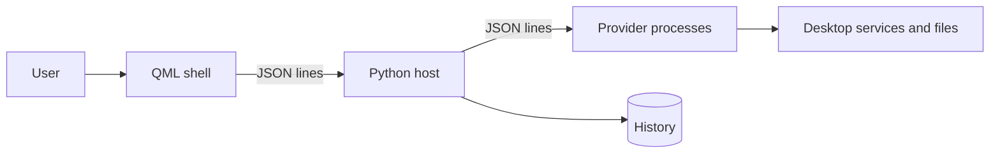

# System architecture

Pallet is an Omarchy command palette with a Quickshell frontend, a Python host and provider subprocesses. The plugin entry points are declared in [manifest.json](../../manifest.json); the overlay instantiates the palette in [PalletOverlay.qml](../../PalletOverlay.qml), and [Service.qml](../../Service.qml) manages the hotkey.

The [shell](../modules/shell.md) starts the [host](../modules/host.md), which discovers [providers](../concepts/provider.md), routes searches, and merges responses. The layers are the [plugin shell](./plugin-shell.md), the [provider host](./provider-host.md), and the [provider contract](./provider-contract.md). See [summon](../flows/summon.md), [search](../flows/search.md), and [execute](../flows/execute.md). The manifest-based protocol is documented in [Provider protocol](../../docs/PROVIDERS.md).
