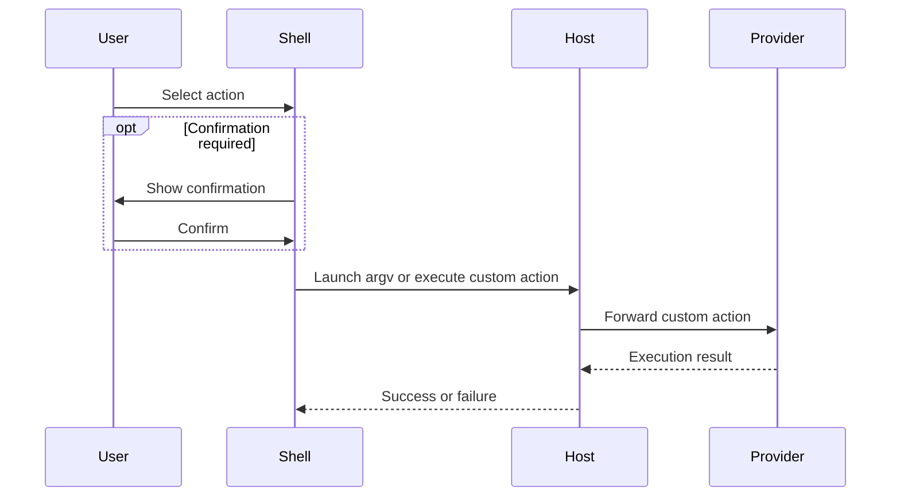

# Execute an action

`executeSelection()` in [PaletteWindow.qml](../../shell/PaletteWindow.qml) opens [confirmation](../concepts/confirmation.md) for gated actions. `execute()` in [ProviderBridge.qml](../../shell/ProviderBridge.qml) handles launch, open, copy, and custom types. Those types are an [action](../concepts/action.md). The [host](../modules/host.md) launches argv or forwards custom actions to the owning [provider](../concepts/provider.md). See [host.py](../../src/host.py), the [provider contract](../architecture/provider-contract.md), and [Provider protocol](../../docs/PROVIDERS.md).
