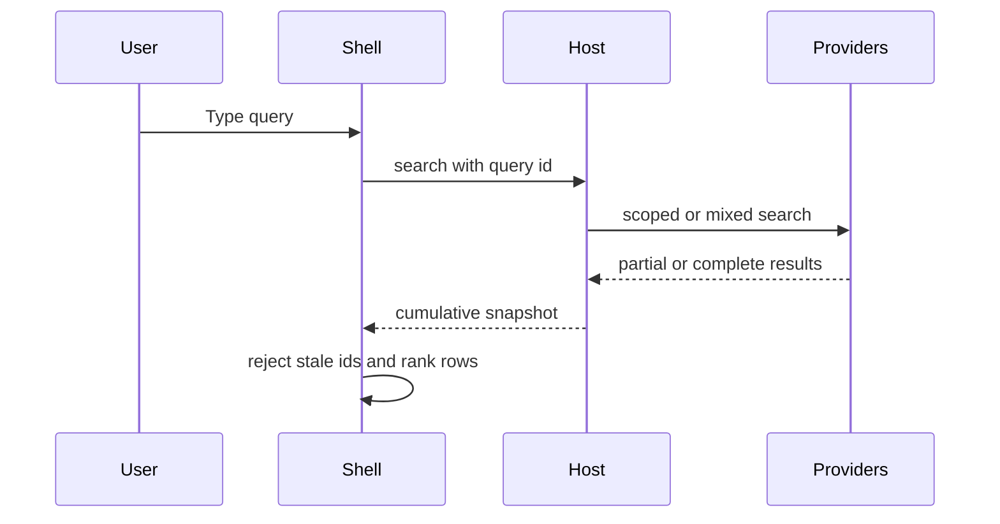

# Search and streaming

Opening the palette is [summon](./summon.md). [PaletteWindow.qml](../../shell/PaletteWindow.qml) debounces input and cancels stale searches. [ProviderBridge.qml](../../shell/ProviderBridge.qml) assigns ids and accepts current responses. `Host.on_search()` and `Host._merge()` in [host.py](../../src/host.py) route the [scope](../concepts/scope.md), merge [provider](../concepts/provider.md) [results](../concepts/result.md), stamp [frecency](../concepts/frecency.md), and report pending or unresolved providers. The [shell](../modules/shell.md) applies [ranking](../concepts/ranking.md) to each snapshot. Routing rules are on the [provider host](../architecture/provider-host.md) page.
