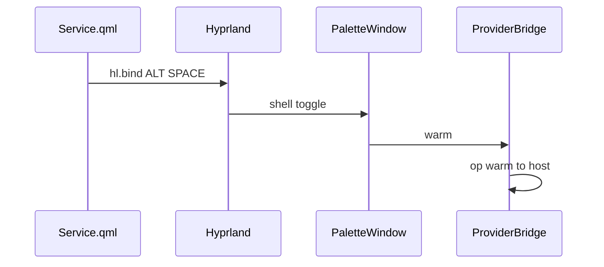

# Summon the palette

## Summary

Summoning Pallet shows the palette and asks providers to warm their caches. The installed trigger is ALT+SPACE. A standalone shell can toggle the same window over Quickshell IPC.

## Trigger

Hyprland runs `omarchy-shell shell toggle io.github.macifyer.pallet`. The overlay entry is [PalletOverlay.qml](../../PalletOverlay.qml), which is a [PaletteWindow](../../shell/PaletteWindow.qml).

## Sequence diagram

## Steps

1. On load, [Service.qml](../../Service.qml) reads current binds. `planBinds()` registers ALT+SPACE only when no existing bind uses that combo. The dispatcher string is `omarchy-shell shell toggle io.github.macifyer.pallet`. The description is `Pallet command palette`.
2. `PaletteWindow.toggle()` shows the window or hides it. `open()` sets the scope label to All.
3. `onVisibleChanged` in [PaletteWindow.qml](../../shell/PaletteWindow.qml) focuses the search field and calls `bridge.warm()` when the window becomes visible. Hiding the window calls `invalidateSearch()`, which cancels the in-flight query.
4. `ProviderBridge.warm()` writes a warm op when the host process is running. `Host.on_warm()` forwards that op to every provider. Providers reply with nothing.
5. [shell.qml](../../shell/shell.qml) exposes `toggle`, `open`, and `close` on the IPC target `pallet` for `qs -p shell`. That path is for standalone development.

## Related

[Plugin shell](../architecture/plugin-shell.md), [search](./search.md), [shell](../modules/shell.md), [plugin notes](../../docs/PLUGIN.md).
